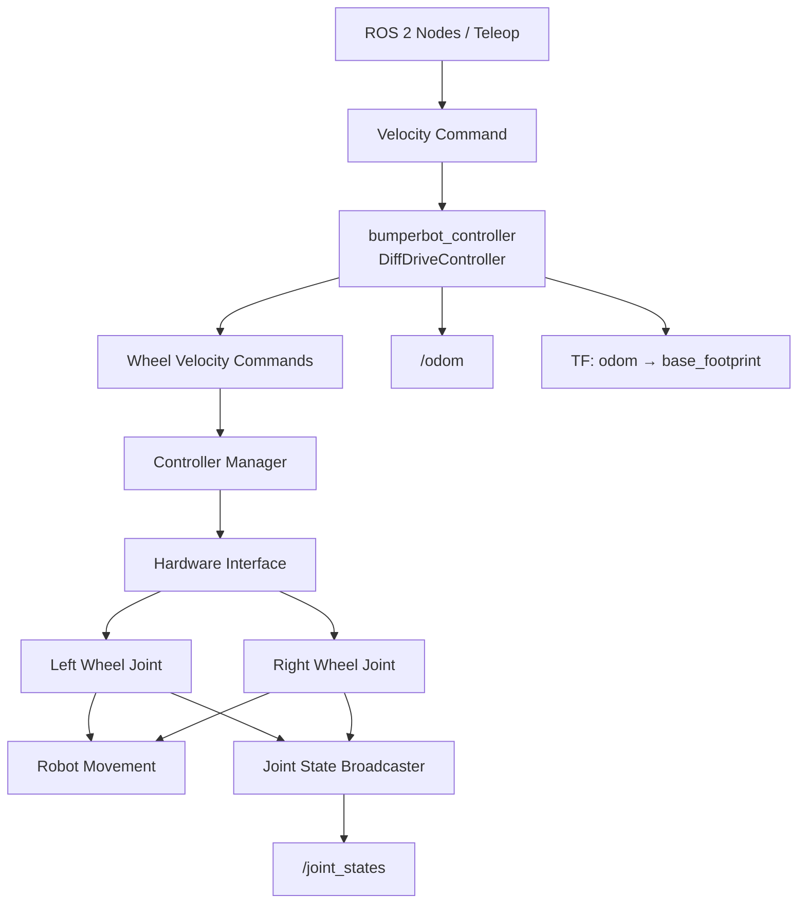

# CẤU HÌNH BUMPERBOT CONTROLLER

## 1. Tổng quan

File cấu hình này khai báo và thiết lập các bộ điều khiển (Controller) được sử dụng để điều khiển robot Bumperbot thông qua ROS 2 Control.

Hệ thống bao gồm 3 bộ điều khiển chính:

- **DiffDriveController:** Điều khiển chuyển động của robot hai bánh vi sai (Differential Drive).
- **JointStateBroadcaster:** Thu thập và phát hành thông tin trạng thái các khớp (Joint State).
- **JointGroupVelocityController:** Điều khiển vận tốc trực tiếp cho nhóm các khớp bánh xe.

Tần số cập nhật của Controller Manager được thiết lập ở mức 100 Hz.

## 2. Controller Manager

`controller_manager` chịu trách nhiệm quản lý, khởi tạo và vận hành các bộ điều khiển trong hệ thống ROS 2 Control.

```yaml
controller_manager:
  ros__parameters:
    update_rate: 100

    bumperbot_controller:
      type: diff_drive_controller/DiffDriveController

    joint_state_broadcaster:
      type: joint_state_broadcaster/JointStateBroadcaster

    simple_velocity_controller:
      type: velocity_controllers/JointGroupVelocityController
```

| Tham số | Mô tả |
|---|---|
| `update_rate` | Tần số cập nhật của Controller Manager (100 Hz). |
| `bumperbot_controller` | Bộ điều khiển chuyển động hai bánh vi sai. |
| `joint_state_broadcaster` | Bộ phát hành trạng thái các khớp. |
| `simple_velocity_controller` | Bộ điều khiển vận tốc trực tiếp cho các khớp bánh xe. |

## 3. Cấu hình Differential Drive Controller

### 3.1. Cấu hình cơ bản

```yaml
bumperbot_controller:
  ros__parameters:
    type: diff_drive_controller/DiffDriveController
    use_stamped_vel: true

    left_wheel_names: ['wheel_left_joint']
    right_wheel_names: ['wheel_right_joint']
```

| Tham số | Mô tả |
|---|---|
| `type` | Khai báo loại bộ điều khiển Differential Drive. |
| `use_stamped_vel` | Sử dụng thông điệp vận tốc `TwistStamped`. |
| `left_wheel_names` | Tên khớp bánh xe bên trái. |
| `right_wheel_names` | Tên khớp bánh xe bên phải. |

Robot nhận lệnh vận tốc tuyến tính và vận tốc góc, sau đó tính toán vận tốc tương ứng cho hai bánh xe.

### 3.2. Cấu hình xuất dữ liệu

```yaml
publish_rate: 50.0

pose_covariance_diagonal: [0.001, 0.001, 1.0e-3, 1.0e-3, 1.0e-3, 0.01]

twist_covariance_diagonal: [0.001, 0.001, 1.0e-3, 1.0e-3, 1.0e-3, 0.01]
```

| Tham số | Mô tả |
|---|---|
| `publish_rate` | Tần số xuất dữ liệu Odometry (50 Hz). |
| `pose_covariance_diagonal` | Các giá trị phương sai biểu thị độ không chắc chắn của vị trí và hướng robot. |
| `twist_covariance_diagonal` | Các giá trị phương sai biểu thị độ không chắc chắn của vận tốc robot. |

Thứ tự các phần tử trong mảng Covariance:

`[x, y, z, roll, pitch, yaw]`

Giá trị càng nhỏ thể hiện mức độ không chắc chắn càng thấp.

### 3.3. Cấu hình thông số bánh xe

```yaml
wheel_separation: 0.17
wheel_radius: 0.033

wheel_separation_multiplier: 1.0
left_wheel_radius_multiplier: 1.0
right_wheel_radius_multiplier: 1.0
```

| Tham số | Giá trị | Đơn vị | Mô tả |
|---|---:|---|---|
| `wheel_separation` | 0.17 | m | Khoảng cách giữa tâm hai bánh xe. |
| `wheel_radius` | 0.033 | m | Bán kính bánh xe. |
| `wheel_separation_multiplier` | 1.0 | - | Hệ số hiệu chỉnh khoảng cách hai bánh xe. |
| `left_wheel_radius_multiplier` | 1.0 | - | Hệ số hiệu chỉnh bán kính bánh trái. |
| `right_wheel_radius_multiplier` | 1.0 | - | Hệ số hiệu chỉnh bán kính bánh phải. |

Các thông số hình học này ảnh hưởng trực tiếp đến khả năng tính toán chuyển động và độ chính xác của Odometry.

### 3.4. Thời gian chờ lệnh vận tốc

```yaml
cmd_vel_timeout: 0.5
```

Thời gian chờ tối đa là 0.5 giây.

Nếu không nhận được lệnh vận tốc mới trong khoảng thời gian này, Controller sẽ tự động đưa vận tốc điều khiển về 0.

Chức năng này giúp hạn chế tình trạng robot tiếp tục di chuyển khi mất nguồn phát lệnh vận tốc.

### 3.5. Cấu hình hệ tọa độ robot

```yaml
base_frame_id: base_footprint
```

Khai báo hệ tọa độ cơ sở của robot được sử dụng trong quá trình tính toán và xuất dữ liệu Odometry.

`base_footprint` là hệ tọa độ chiếu của robot lên mặt phẳng mặt đất, thường được sử dụng trong các hệ thống robot di động.

### 3.6. Các tùy chọn xuất dữ liệu

```yaml
publish_limited_velocity: true
publish_wheel_data: true
enable_odom_tf: true
```

| Tham số | Mô tả |
|---|---|
| `publish_limited_velocity` | Cho phép xuất lệnh vận tốc sau khi đã áp dụng các giới hạn điều khiển. |
| `publish_wheel_data` | Cho phép xuất dữ liệu liên quan đến bánh xe. |
| `enable_odom_tf` | Cho phép Controller trực tiếp phát hành biến đổi tọa độ từ `odom` đến `base_frame_id`. |

### 3.7. Giới hạn vận tốc tuyến tính

```yaml
linear:
  x:
    has_velocity_limits: true
    max_velocity: 0.7
    min_velocity: -0.7

    has_acceleration_limits: true
    max_acceleration: 0.7
    min_acceleration: -0.7

    has_jerk_limits: false
    max_jerk: 5.0
```

| Tham số | Giá trị | Đơn vị | Mô tả |
|---|---:|---|---|
| `has_velocity_limits` | true | - | Kích hoạt giới hạn vận tốc. |
| `max_velocity` | 0.7 | m/s | Vận tốc tiến tối đa. |
| `min_velocity` | -0.7 | m/s | Vận tốc lùi tối đa theo độ lớn. |
| `has_acceleration_limits` | true | - | Kích hoạt giới hạn gia tốc. |
| `max_acceleration` | 0.7 | m/s² | Gia tốc tiến tối đa. |
| `min_acceleration` | -0.7 | m/s² | Gia tốc lùi tối đa. |
| `has_jerk_limits` | false | - | Không kích hoạt giới hạn Jerk. |
| `max_jerk` | 5.0 | m/s³ | Giá trị Jerk tối đa được khai báo. |

### 3.8. Giới hạn vận tốc góc

```yaml
angular:
  z:
    has_velocity_limits: true
    max_velocity: 8.5
    min_velocity: -8.5

    has_acceleration_limits: true
    max_acceleration: 5.0
    min_acceleration: -5.0

    has_jerk_limits: false
    max_jerk: 2.5
```

| Tham số | Giá trị | Đơn vị | Mô tả |
|---|---:|---|---|
| `has_velocity_limits` | true | - | Kích hoạt giới hạn vận tốc góc. |
| `max_velocity` | 8.5 | rad/s | Vận tốc góc tối đa theo chiều dương. |
| `min_velocity` | -8.5 | rad/s | Vận tốc góc tối đa theo chiều âm. |
| `has_acceleration_limits` | true | - | Kích hoạt giới hạn gia tốc góc. |
| `max_acceleration` | 5.0 | rad/s² | Gia tốc góc tối đa. |
| `min_acceleration` | -5.0 | rad/s² | Gia tốc góc tối thiểu. |
| `has_jerk_limits` | false | - | Không kích hoạt giới hạn Jerk. |
| `max_jerk` | 2.5 | rad/s³ | Giá trị Jerk góc tối đa được khai báo. |

## 4. Simple Velocity Controller

```yaml
simple_velocity_controller:
  ros__parameters:
    joints:
      - wheel_left_joint
      - wheel_right_joint
```

Bộ điều khiển này cho phép điều khiển vận tốc trực tiếp cho từng khớp bánh xe.

| Tham số | Mô tả |
|---|---|
| `joints` | Danh sách các khớp bánh xe được bộ điều khiển quản lý. |

Ứng dụng:
- Kiểm tra hoạt động riêng lẻ của từng bánh xe.
- Kiểm tra chiều quay động cơ.
- Thử nghiệm điều khiển vận tốc ở mức thấp.
- Phục vụ quá trình kiểm tra và hiệu chỉnh phần cứng robot.

**Lưu ý:** Không nên kích hoạt đồng thời `simple_velocity_controller` và `bumperbot_controller` nếu cả hai cùng yêu cầu điều khiển các giao diện vận tốc của hai bánh xe.

## 5. Sơ đồ kiến trúc điều khiển

```text
          ROS 2 Navigation / Teleoperation
                       |
                       v
                  /cmd_vel
                       |
                       v
             Bumperbot Controller
              (DiffDriveController)
                       |
              +--------+--------+
              |                 |
              v                 v
         Left Wheel        Right Wheel
              |                 |
              +--------+--------+
                       |
                       v
                  Robot Motion
                       |
                       v
                 Odometry / TF
```


Nguyên lý hoạt động:

1. Hệ thống Navigation hoặc Teleoperation gửi lệnh vận tốc đến Controller.
2. `DiffDriveController` tiếp nhận lệnh vận tốc tuyến tính và vận tốc góc.
3. Controller tính toán vận tốc cần thiết cho bánh trái và bánh phải.
4. ROS 2 Control truyền lệnh đến các giao diện điều khiển phần cứng.
5. Robot thực hiện chuyển động.
6. Dữ liệu trạng thái bánh xe được sử dụng để tính toán Odometry.
7. Controller phát hành thông tin Odometry và TF để các thành phần khác trong ROS 2 sử dụng.

`JointStateBroadcaster` hoạt động độc lập để phát hành trạng thái các khớp robot.

## 6. Khởi tạo và kích hoạt Controller

Sau khi khởi chạy Robot và Controller Manager, thực hiện kích hoạt các Controller:

**Bước 1: Kích hoạt Joint State Broadcaster**

```bash
ros2 control load_controller --set-state active joint_state_broadcaster
```

**Bước 2: Kích hoạt Differential Drive Controller**

```bash
ros2 control load_controller --set-state active bumperbot_controller
```

Nếu muốn sử dụng bộ điều khiển vận tốc trực tiếp, có thể kích hoạt thay thế:

```bash
ros2 control load_controller --set-state active simple_velocity_controller
```

**Kiểm tra trạng thái các Controller:**

```bash
ros2 control list_controllers
```

**Kiểm tra các giao diện phần cứng:**

```bash
ros2 control list_hardware_interfaces
```

## 7. Kiểm tra hoạt động

**Kiểm tra danh sách Topic:**

```bash
ros2 topic list
```

**Kiểm tra dữ liệu Odometry:**

```bash
ros2 topic echo /odom
```

**Kiểm tra biến đổi tọa độ TF:**

```bash
ros2 run tf2_ros tf2_echo odom base_footprint
```

Do `use_stamped_vel` được thiết lập là `true`, lệnh vận tốc phải sử dụng kiểu dữ liệu:

```text
geometry_msgs/msg/TwistStamped
```

Không sử dụng `geometry_msgs/msg/Twist` để gửi lệnh trực tiếp đến Topic điều khiển này.

## 8. Các lưu ý khi cấu hình

1. Đảm bảo tên các Joint trong file YAML trùng khớp với URDF và cấu hình `ros2_control`.
2. Kiểm tra chính xác bán kính bánh xe và khoảng cách giữa hai bánh xe trên robot thực tế.
3. Hiệu chỉnh các hệ số bán kính bánh xe để cải thiện độ chính xác của Odometry.
4. Điều chỉnh giới hạn vận tốc và gia tốc phù hợp với khả năng cơ khí của robot.
5. Chỉ sử dụng một Controller điều khiển vận tốc cho cùng một nhóm giao diện bánh xe tại một thời điểm.
6. Đảm bảo hệ tọa độ `base_footprint` được khai báo và tồn tại trong TF Tree.
7. Khi thử nghiệm robot thực tế, nên bắt đầu với vận tốc thấp trước khi tăng giới hạn điều khiển.
8. Kiểm tra phiên bản `ros2_controllers` để đảm bảo các tham số cấu hình tương thích.

## 9. Bảng tổng hợp thông số

| Thông số | Giá trị |
|---|---|
| Tần số cập nhật Controller Manager | 100 Hz |
| Tần số xuất Odometry | 50 Hz |
| Khoảng cách hai bánh xe | 0.17 m |
| Bán kính bánh xe | 0.033 m |
| Vận tốc tuyến tính tối đa | 0.7 m/s |
| Vận tốc góc tối đa | 8.5 rad/s |
| Gia tốc tuyến tính | ±0.7 m/s² |
| Gia tốc góc | ±5.0 rad/s² |
| Thời gian chờ lệnh vận tốc | 0.5 s |
| Hệ tọa độ cơ sở | `base_footprint` |
| Kiểu dữ liệu vận tốc | `TwistStamped` |

---

**Thông tin dự án**

- **Dự án:** RobotSlam
- **Robot:** Bumperbot
- **Thành phần:** ROS 2 Control
- **File cấu hình:** `bumperbot_controller.yaml`
- **Chức năng:** Cấu hình và quản lý bộ điều khiển chuyển động robot hai bánh vi sai.