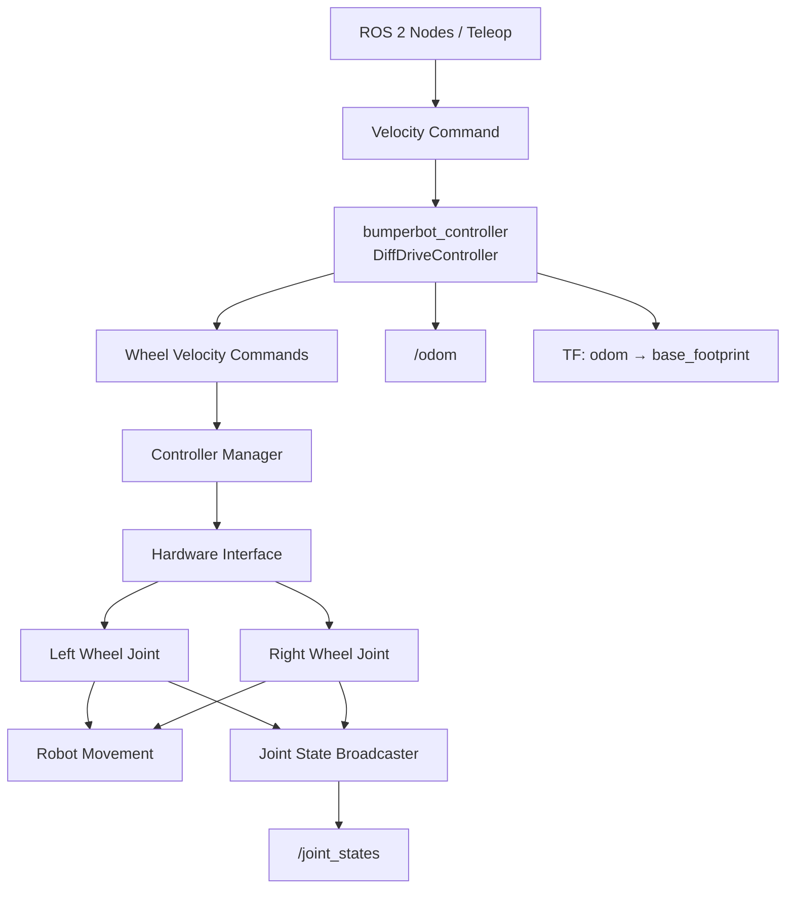

# Configuration – ROS 2 Controllers

## 1. Giới thiệu

Thư mục này chứa các file cấu hình YAML phục vụ việc thiết lập và quản lý các thành phần điều khiển robot trong hệ thống ROS 2.

Các cấu hình được sử dụng để:
- Thiết lập `controller_manager` và tần số cập nhật hệ thống.
- Cấu hình Differential Drive Controller.
- Cấu hình Joint State Broadcaster.
- Cấu hình Joint Group Velocity Controller.
- Thiết lập Joystick Driver.
- Cấu hình Joystick Teleoperation để điều khiển robot bằng tay cầm.

Các thành phần sử dụng ROS 2 Control và các package hỗ trợ điều khiển robot.

---

## 2. Cấu trúc hệ thống

File YAML bao gồm 5 nhóm cấu hình chính:

| Thành phần | Chức năng |
|---|---|
| `controller_manager` | Quản lý và khởi tạo các controller. |
| `bumperbot_controller` | Điều khiển chuyển động robot theo mô hình Differential Drive. |
| `simple_velocity_controller` | Điều khiển vận tốc các khớp bánh xe. |
| `joystick` | Đọc dữ liệu đầu vào từ tay cầm điều khiển. |
| `joy_teleop` | Chuyển đổi dữ liệu Joystick thành lệnh vận tốc robot. |

---

## 3. Controller Manager

### 3.1. Giới thiệu

`controller_manager` là thành phần trung tâm của ROS 2 Control, chịu trách nhiệm quản lý vòng đời của các controller và điều phối quá trình cập nhật trạng thái, lệnh điều khiển phần cứng.

### 3.2. Parameters

| Parameter | Giá trị | Đơn vị | Mô tả |
|---|---:|---|---|
| `update_rate` | 100 | Hz | Tần số cập nhật của Controller Manager. |
| `bumperbot_controller.type` | `diff_drive_controller/DiffDriveController` | - | Loại Differential Drive Controller. |
| `joint_state_broadcaster.type` | `joint_state_broadcaster/JointStateBroadcaster` | - | Loại Joint State Broadcaster. |
| `simple_velocity_controller.type` | `velocity_controllers/JointGroupVelocityController` | - | Loại Group Velocity Controller. |

### 3.3. Controller được quản lý

---
### 🔧 Differential Drive Controller
---
Điều khiển robot sử dụng hai bánh xe truyền động độc lập.

**Joint State Broadcaster**

Đọc trạng thái các khớp từ Hardware Interface và xuất bản thông tin lên topic `joint_states`.

**Joint Group Velocity Controller**

Cho phép gửi lệnh vận tốc trực tiếp đến một nhóm khớp bánh xe.

---

## 4. Differential Drive Controller

### 4.1. Giới thiệu

`bumperbot_controller` sử dụng package `diff_drive_controller` để thực hiện điều khiển chuyển động robot hai bánh vi sai.

Controller nhận lệnh vận tốc tuyến tính và vận tốc góc, sau đó tính toán vận tốc góc tương ứng cho bánh trái và bánh phải.

Ngoài ra, controller còn tính toán Odometry dựa trên trạng thái Encoder của hai bánh xe.

### 4.2. Cấu hình bánh xe

| Parameter | Giá trị | Đơn vị | Mô tả |
|---|---:|---|---|
| `left_wheel_names` | `wheel_left_joint` | - | Tên khớp bánh xe bên trái. |
| `right_wheel_names` | `wheel_right_joint` | - | Tên khớp bánh xe bên phải. |
| `wheel_separation` | 0.17 | m | Khoảng cách giữa tâm hai bánh xe. |
| `wheel_radius` | 0.033 | m | Bán kính bánh xe. |
| `wheel_separation_multiplier` | 1.0 | - | Hệ số hiệu chỉnh khoảng cách hai bánh. |
| `left_wheel_radius_multiplier` | 1.0 | - | Hệ số hiệu chỉnh bán kính bánh trái. |
| `right_wheel_radius_multiplier` | 1.0 | - | Hệ số hiệu chỉnh bán kính bánh phải. |

### 4.3. Velocity Command

| Parameter | Giá trị | Mô tả |
|---|---|---|
| `use_stamped_vel` | `true` | Sử dụng message `TwistStamped` cho lệnh vận tốc. |
| `cmd_vel_timeout` | 0.5 s | Thời gian chờ tối đa của lệnh vận tốc trước khi controller dừng robot. |

Topic nhận lệnh vận tốc:

```text
/bumperbot_controller/cmd_vel
```

Message Type:

```text
geometry_msgs/msg/TwistStamped
```

### 4.4. Odometry Configuration

| Parameter | Giá trị | Mô tả |
|---|---:|---|
| `publish_rate` | 50.0 Hz | Tần số xuất bản Odometry. |
| `pose_covariance_diagonal` | `[0.001, 0.001, 0.001, 0.001, 0.001, 0.01]` | Đường chéo ma trận hiệp phương sai của Pose. |
| `twist_covariance_diagonal` | `[0.001, 0.001, 0.001, 0.001, 0.001, 0.01]` | Đường chéo ma trận hiệp phương sai của Twist. |
| `base_frame_id` | `base_footprint` | Frame đại diện cho phần đế robot. |
| `enable_odom_tf` | `true` | Cho phép controller xuất bản TF từ Odometry. |

**Pose Covariance**

Biểu diễn độ không chắc chắn của vị trí và hướng robot.

Thứ tự các phần tử:

```text
[x, y, z, roll, pitch, yaw]
```

**Twist Covariance**

Biểu diễn độ không chắc chắn của vận tốc tuyến tính và vận tốc góc theo cùng thứ tự:

```text
[vx, vy, vz, wx, wy, wz]
```

Các giá trị trên đường chéo biểu diễn phương sai tương ứng của từng thành phần.

### 4.5. Publishing Options

| Parameter | Giá trị | Mô tả |
|---|---|---|
| `publish_limited_velocity` | `true` | Xuất bản vận tốc sau khi áp dụng giới hạn. |
| `publish_wheel_data` | `true` | Xuất bản dữ liệu liên quan đến trạng thái bánh xe. |
| `enable_odom_tf` | `true` | Xuất bản phép biến đổi TF Odometry. |

### 4.6. Velocity and Acceleration Limits

Các giới hạn được sử dụng để kiểm soát vận tốc, gia tốc và jerk của robot.

#### Linear Velocity – Trục X

| Parameter | Giá trị | Đơn vị | Mô tả |
|---|---:|---|---|
| `has_velocity_limits` | true | - | Kích hoạt giới hạn vận tốc. |
| `max_velocity` | 0.7 | m/s | Vận tốc tuyến tính tối đa. |
| `min_velocity` | -0.7 | m/s | Vận tốc tuyến tính tối thiểu. |
| `has_acceleration_limits` | true | - | Kích hoạt giới hạn gia tốc. |
| `max_acceleration` | 0.7 | m/s² | Gia tốc tối đa. |
| `min_acceleration` | -0.7 | m/s² | Gia tốc tối thiểu. |
| `has_jerk_limits` | false | - | Không kích hoạt giới hạn jerk. |
| `max_jerk` | 5.0 | m/s³ | Giá trị jerk tối đa được khai báo. |

#### Angular Velocity – Trục Z

| Parameter | Giá trị | Đơn vị | Mô tả |
|---|---:|---|---|
| `has_velocity_limits` | true | - | Kích hoạt giới hạn vận tốc góc. |
| `max_velocity` | 8.5 | rad/s | Vận tốc góc tối đa. |
| `min_velocity` | -8.5 | rad/s | Vận tốc góc tối thiểu. |
| `has_acceleration_limits` | true | - | Kích hoạt giới hạn gia tốc góc. |
| `max_acceleration` | 5.0 | rad/s² | Gia tốc góc tối đa. |
| `min_acceleration` | -5.0 | rad/s² | Gia tốc góc tối thiểu. |
| `has_jerk_limits` | false | - | Không kích hoạt giới hạn jerk. |
| `max_jerk` | 2.5 | rad/s³ | Giá trị jerk góc tối đa được khai báo. |

---

## 5. Simple Velocity Controller

### 5.1. Giới thiệu

`simple_velocity_controller` sử dụng package `velocity_controllers/JointGroupVelocityController` để gửi lệnh vận tốc đến các khớp bánh xe.

Controller được cấu hình để điều khiển hai khớp:

```yaml
joints:
  - wheel_left_joint
  - wheel_right_joint
```

### 5.2. Parameters

| Parameter | Giá trị | Mô tả |
|---|---|---|
| `joints` | `wheel_left_joint` | Khớp bánh trái. |
| `joints` | `wheel_right_joint` | Khớp bánh phải. |

Controller nhận một mảng vận tốc và phân phối đến các khớp theo thứ tự khai báo.

---

## 6. Joystick Driver

### 6.1. Giới thiệu

`joystick` sử dụng package `joy` để đọc dữ liệu từ tay cầm điều khiển được kết nối với máy tính.

Node chuyển đổi tín hiệu vật lý từ các nút bấm và cần analog thành dữ liệu ROS 2.

### 6.2. Parameters

| Parameter | Giá trị | Mô tả |
|---|---:|---|
| `device_id` | 0 | ID thiết bị Joystick. |
| `device_name` | `""` | Tên thiết bị Joystick. Để trống để lựa chọn theo ID. |
| `deadzone` | 0.5 | Vùng chết của tín hiệu analog. |
| `autorepeat_rate` | 20.0 Hz | Tần số lặp lại dữ liệu khi không có thay đổi. |
| `sticky_buttons` | false | Không giữ trạng thái nút bấm sau khi thả. |
| `coalesce_interval_ms` | 1 ms | Khoảng thời gian gộp các sự kiện đầu vào. |

**Deadzone**

Deadzone giúp loại bỏ các tín hiệu analog nhỏ khi cần điều khiển ở vị trí trung tâm, tránh hiện tượng robot tự di chuyển do sai lệch tín hiệu Joystick.

---

## 7. Joystick Teleoperation

### 7.1. Giới thiệu

`joy_teleop` sử dụng package `joy_teleop` để chuyển đổi dữ liệu Joystick thành lệnh vận tốc điều khiển robot.

Node nhận dữ liệu từ Joystick và tạo message `TwistStamped` để gửi đến Differential Drive Controller.

### 7.2. General Configuration

| Parameter | Giá trị | Mô tả |
|---|---|---|
| `type` | `topic` | Điều khiển thông qua ROS 2 Topic. |
| `interface_type` | `geometry_msgs/msg/TwistStamped` | Kiểu message vận tốc. |
| `topic_name` | `bumperbot_controller/cmd_vel` | Topic nhận lệnh vận tốc. |
| `deadman_buttons` | `[5]` | Nút giữ để cho phép robot di chuyển. |

**Deadman Button**

Nút số 5 phải được giữ trong quá trình điều khiển. Khi thả nút, thao tác điều khiển bị vô hiệu hóa.

### 7.3. Axis Mapping

#### Linear Velocity – X Axis

| Parameter | Giá trị | Mô tả |
|---|---:|---|
| `axis` | 1 | Trục analog điều khiển tiến/lùi. |
| `scale` | 1.0 | Hệ số nhân tín hiệu. |
| `offset` | 0.0 | Giá trị bù tín hiệu. |

Giá trị đầu vào được ánh xạ vào:

```text
TwistStamped.twist.linear.x
```

#### Angular Velocity – Z Axis

| Parameter | Giá trị | Mô tả |
|---|---:|---|
| `axis` | 3 | Trục analog điều khiển quay trái/phải. |
| `scale` | 8.0 | Hệ số nhân tín hiệu. |
| `offset` | 0.0 | Giá trị bù tín hiệu. |

Giá trị đầu vào được ánh xạ vào:

```text
TwistStamped.twist.angular.z
```

---

## 8. Control Data Flow

Luồng dữ liệu điều khiển robot bằng Joystick:



Các thành phần có chức năng riêng biệt:

1. `joy_node`: Đọc tín hiệu vật lý từ Joystick.
2. `joy_teleop`: Chuyển đổi tín hiệu Joystick thành lệnh vận tốc.
3. `bumperbot_controller`: Tính toán vận tốc cho hai bánh xe.
4. `Robot Hardware`: Thực thi lệnh điều khiển.
5. `joint_state_broadcaster`: Xuất bản trạng thái khớp bánh xe.

---

## 9. Dependencies

Các ROS 2 Packages cần thiết:

| Package | Chức năng |
|---|---|
| `controller_manager` | Quản lý các controller. |
| `diff_drive_controller` | Điều khiển robot Differential Drive. |
| `joint_state_broadcaster` | Xuất bản trạng thái khớp. |
| `velocity_controllers` | Điều khiển vận tốc các khớp. |
| `joy` | Đọc dữ liệu từ Joystick. |
| `joy_teleop` | Chuyển đổi Joystick thành lệnh điều khiển. |
| `geometry_msgs` | Kiểu dữ liệu TwistStamped. |

---

## 10. Kiểm tra hoạt động

Kiểm tra các controller:

```bash
ros2 control list_controllers
```

Kiểm tra các topic:

```bash
ros2 topic list
```

Kiểm tra dữ liệu Joystick:

```bash
ros2 topic echo /joy
```

Kiểm tra lệnh vận tốc:

```bash
ros2 topic echo /bumperbot_controller/cmd_vel
```

Kiểm tra trạng thái bánh xe:

```bash
ros2 topic echo /joint_states
```

Kiểm tra Odometry:

```bash
ros2 topic echo /bumperbot_controller/odom
```

---

## 11. Technical Notes

- `controller_manager.update_rate` được thiết lập ở 100 Hz, tương ứng chu kỳ cập nhật 10 ms.
- `bumperbot_controller.publish_rate` được thiết lập ở 50 Hz, tương ứng chu kỳ xuất bản 20 ms.
- Các giới hạn vận tốc và gia tốc giúp kiểm soát chuyển động, hạn chế lệnh điều khiển vượt quá khả năng vận hành của robot.
- `cmd_vel_timeout` giúp robot dừng khi không nhận được lệnh vận tốc mới trong khoảng thời gian quy định.
- `pose_covariance_diagonal` và `twist_covariance_diagonal` cung cấp thông tin độ không chắc chắn của Odometry cho các thuật toán hợp nhất cảm biến.
- `deadman_buttons` giúp hạn chế chuyển động ngoài ý muốn khi sử dụng Joystick.

**Project:** RobotSlam  
**Framework:** ROS 2 Jazzy  
**Control Framework:** ROS 2 Control  
**Configuration Format:** YAML