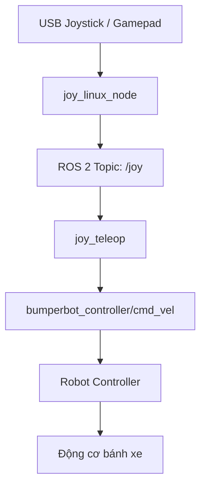
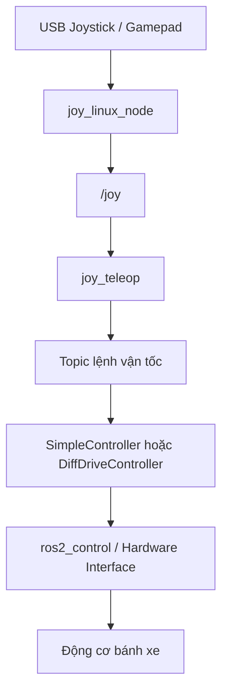

# RobotSlam – Tài liệu kiến trúc ROS 2

Thư mục này lưu trữ tài liệu kỹ thuật, sơ đồ kiến trúc và luồng hoạt động của dự án **RobotSlam**.

Các sơ đồ được viết bằng [Mermaid](https://mermaid.js.org/) trong Markdown để dễ chỉnh sửa, xem trước và quản lý phiên bản bằng Git.

## 1. Cấu trúc tài liệu


docs/
├── README.md
│
├── architecture/
│   ├── ros2_joystick_flow.md
│   └── ros2_control_flow.md
│
└── img/
    ├── ros2_joystick_flow.png
    └── ros2_control_flow.png


| Tài liệu | Nội dung |
|---|---|
| `joystick_teleop.launch.py` | Luồng điều khiển robot bằng USB Joystick/Gamepad |
| `controller.launch.py` | Kiến trúc `ros2_control`, Controller Manager và bộ điều khiển bánh xe |

> Các file trong danh sách là cấu trúc tài liệu đề xuất. Hãy tạo từng file khi nội dung tương ứng đã sẵn sàng.

## 2. Xem sơ đồ Mermaid trong VS Code

Cài extension hỗ trợ Mermaid trong Markdown Preview. Sau đó:

1. Mở file `.md` có chứa sơ đồ.
2. Nhấn `Ctrl + Shift + V` để mở Markdown Preview.
3. Hoặc nhấn `Ctrl + K`, sau đó `V` để mở Preview bên cạnh.
4. Di chuột lên sơ đồ để sử dụng các nút zoom, pan và reset.

Sơ đồ Mermaid:



## 3. Quy ước viết tài liệu

- Mỗi file tập trung vào một chủ đề hoặc một luồng chức năng.
- Dùng tiêu đề Markdown (`#`, `##`, `###`) để chia nội dung.
- Dùng khối mã `mermaid` để tạo sơ đồ.
- Ghi rõ tên ROS 2 package, node, topic, service, action và TF frame khi đề cập.
- Phân biệt topic thực tế đang chạy với topic minh họa trong sơ đồ.
- Cập nhật tài liệu khi thay đổi kiến trúc hoặc cấu hình trong source code.

## 4. Luồng Joystick tham khảo

Luồng tổng quát khi điều khiển robot bằng tay:



Tên topic lệnh vận tốc cần được kiểm tra trong file cấu hình `joy_teleop.yaml` và cấu hình controller của dự án; không mặc định rằng mọi hệ thống đều sử dụng `/cmd_vel`.

## 5. Kiểm tra nhanh các topic ROS 2

Sau khi khởi chạy các node liên quan, có thể kiểm tra bằng các lệnh:

```bash
# Liệt kê các topic đang hoạt động
ros2 topic list

# Kiểm tra dữ liệu joystick
ros2 topic echo /joy

# Kiểm tra kiểu dữ liệu của một topic
ros2 topic type /joy

# Xem thông tin publisher/subscriber của một topic
ros2 topic info /joy
```

Đối với topic lệnh vận tốc, thay tên topic trong lệnh `ros2 topic echo` bằng đúng tên được cấu hình trong dự án.

## 6. Đóng góp và cập nhật

Khi thêm tài liệu mới:

1. Tạo file Markdown trong thư mục phù hợp.
2. Thêm mô tả file vào bảng ở mục **Cấu trúc tài liệu**.
3. Kiểm tra sơ đồ trong VS Code Markdown Preview.
4. Commit và push thay đổi lên nhánh Git đang làm việc.

---

**Project:** RobotSlam  
**Documentation:** ROS 2 Architecture  
**Diagram format:** Mermaid 11.x
